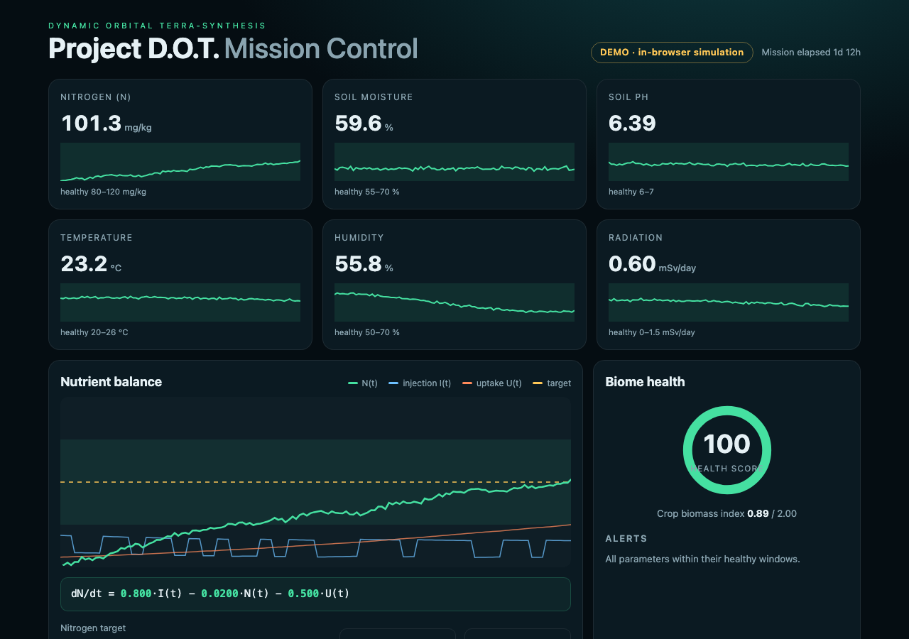

<p align="center">
  
</p>

# Project D.O.T. — Dynamic Orbital Terra-synthesis

> An autonomous, IoT-driven biodome that synthesizes soil from organic waste and keeps the biome in its healthy window, so crops can grow in space without resupply from Earth.

[**Live demo →**](http://organize-with.me/project-dot-orbital-soil/) · [Issues](https://github.com/zainkhan1994/project-dot-orbital-soil/issues) · [Model](docs/model.md) · [Scope](SCOPE.md) · [Glossary](GLOSSARY.md)

[](http://organize-with.me/project-dot-orbital-soil/)    

## The Problem

Mars and beyond cannot be resupplied from Earth. Food has to be grown where the crew lives, and in microgravity soil is hard: water pools or floats away, nutrients decay and are consumed unevenly, and radiation stresses plants. A human cannot babysit a biome around the clock.

## The Fix

Project D.O.T. closes the loop. Sensors report soil nitrogen, moisture, pH, temperature and humidity; a controller injects nutrient to hold nitrogen at its target using a physical model of the soil; the model's coefficients are re-calibrated from telemetry; and a mission-control dashboard shows biome health and alerts in real time.

$$\frac{dN}{dt} = \alpha\,I(t) - \beta\,N(t) - \gamma\,U(t)$$

`N` nutrient concentration · `I` automated injection rate · `U` crop uptake · `α, β, γ` conversion, decay and absorption coefficients, calibrated from data.

### What's in the repo

- **Nutrient model + controller** (feed-forward + PI, anti-windup, probing signal) in `backend/dot/`
- **Calibration** of α, β, γ by instrumental variables, with measured accuracy in [docs/model.md](docs/model.md)
- **Flask API** with a built-in biome simulator, so everything runs without hardware
- **React mission-control dashboard**: six live sensors, nutrient chart, equation with live coefficients, health score, alerts, solar-storm and calibrate buttons
- **Arduino firmware** and a **serial bridge** for the physical pod (not compiled or flashed in CI)
- **Optional TensorFlow forecaster** (`ml/forecast_tf.py`, not run in CI)
- 18 automated tests (12 Python, 6 JavaScript)

<details>
<summary><strong>Setup — macOS</strong></summary>

Prerequisites: Python 3.10+ (`brew install python`), Node.js 20+ (`brew install node`), git.

```bash
git clone https://github.com/zainkhan1994/project-dot-orbital-soil.git
cd project-dot-orbital-soil

# backend (simulation mode)
python3 -m venv .venv && source .venv/bin/activate
pip install -r backend/requirements.txt -r backend/requirements-dev.txt
python -m pytest -q
(cd backend && python run.py)          # http://localhost:5000

# dashboard (second terminal)
cd dashboard && npm install && npm run dev
```

Open the dashboard URL printed by Vite. It starts in **demo mode**; to use the backend open it with `?api=http://localhost:5000`.

</details>

<details>
<summary><strong>Setup — Linux</strong></summary>

Prerequisites: Python 3.10+, Node.js 20+ (via [nvm](https://github.com/nvm-sh/nvm) or your package manager), git.

```bash
git clone https://github.com/zainkhan1994/project-dot-orbital-soil.git
cd project-dot-orbital-soil
python3 -m venv .venv && source .venv/bin/activate
pip install -r backend/requirements.txt -r backend/requirements-dev.txt
python -m pytest -q
(cd backend && python run.py)

cd dashboard && npm install && npm run dev      # second terminal
```

For the pod: `DOT_SIMULATE=0 python backend/run.py` and `python bridge/serial_bridge.py --port /dev/ttyUSB0`.

</details>

<details>
<summary><strong>Setup — Windows</strong></summary>

Prerequisites: Python 3.10+ (`winget install Python.Python.3.12`), Node.js 20+ (`winget install OpenJS.NodeJS.LTS`), git. Use PowerShell.

```powershell
git clone https://github.com/zainkhan1994/project-dot-orbital-soil.git
cd project-dot-orbital-soil
py -m venv .venv
.venv\Scripts\Activate.ps1
pip install -r backend\requirements.txt -r backend\requirements-dev.txt
python -m pytest -q
cd backend; python run.py                          # http://localhost:5000

# second terminal
cd dashboard; npm install; npm run dev
```

For the pod: `$env:DOT_SIMULATE="0"; python run.py`, then `python bridge\serial_bridge.py --port COM3`.

</details>

<details>
<summary><strong>Architecture</strong></summary>

```
pod sensors ─► Arduino ─► serial bridge ─► Flask API ◄─ React dashboard (polls 1 s)
 (NPK, pH, moisture,        POST /api/ingest   │  history · health · alerts · calibrate · set-point
  temp, humidity)                              └─ built-in simulator when no hardware is attached
```

Modes: **simulation** (default), **hardware** (`DOT_SIMULATE=0`), and **demo** (dashboard only, in-browser model; what GitHub Pages serves). Details: [docs/architecture.md](docs/architecture.md), [docs/api.md](docs/api.md), [docs/hardware.md](docs/hardware.md).

| Path | Purpose |
|---|---|
| `backend/dot/` | model, controller, calibration, simulator, Flask app |
| `dashboard/` | Vite + React mission-control UI and a JS port of the model |
| `firmware/dot_pod/` | Arduino sketch (NPK over RS485, pH, moisture, DHT22) |
| `bridge/` | serial-to-HTTP forwarder |
| `ml/` | optional TensorFlow forecaster |
| `docs/` | model, architecture, API, hardware notes |
| `devpost/SUBMISSION.md` | copy for the hackathon submission |

</details>

<details>
<summary><strong>Tech stack</strong></summary>

- Python, Flask, NumPy, pytest
- React 18, Vite, Vitest
- Arduino C++ (DHT, SoftwareSerial, Modbus RTU over RS485)
- Optional: TensorFlow / Keras
- GitHub Actions (tests, Pages deploy)

</details>

<details>
<summary><strong>Screenshots</strong></summary>


_The dashboard in demo mode (in-browser simulation)._ Hardware photos and CAD are not in this repository.

</details>

<details>
<summary><strong>Changelog</strong></summary>

- 2026-10-11 — Initial release: nutrient model, controller, IV calibration, Flask API, React dashboard, firmware, bridge, docs and tests.

Full history: [CHANGELOG.md](CHANGELOG.md).

</details>

## Honest status

- Verified here: the model, controller, calibration, API, bridge parser and dashboard, by 18 automated tests and a production build.
- **Not verified in this repository:** the Arduino sketch (not compiled or flashed), the TensorFlow script (not run), and the physical pod itself.
- Radiation is not measured by the firmware; the bridge uses a fixed value until a dosimeter is added.

## For agents and contributors

- [`AGENTS.md`](AGENTS.md) / [`CLAUDE.md`](CLAUDE.md) — commands, structure, conventions
- [`SCOPE.md`](SCOPE.md) — what this project will and won't do
- [`GLOSSARY.md`](GLOSSARY.md) — shared vocabulary
- Issues are tracked in [GitHub Issues](https://github.com/zainkhan1994/project-dot-orbital-soil/issues); docs live in [`docs/`](docs/).

## License

MIT — see [LICENSE](LICENSE).
